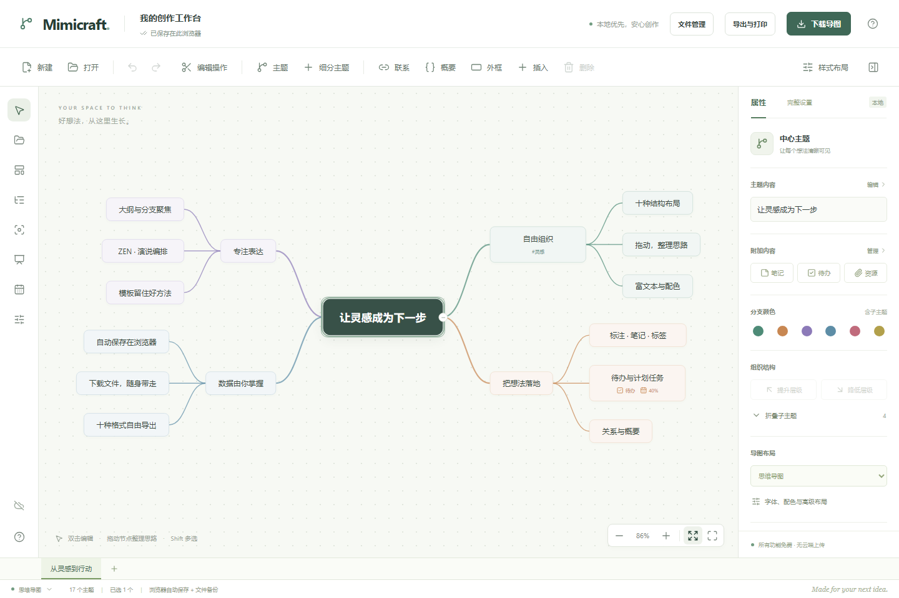
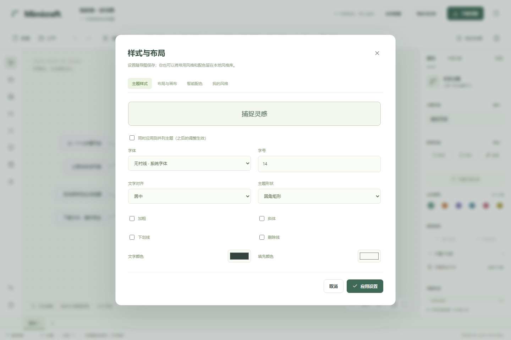
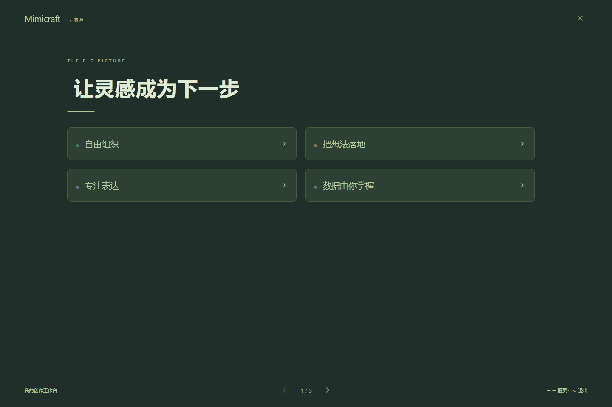
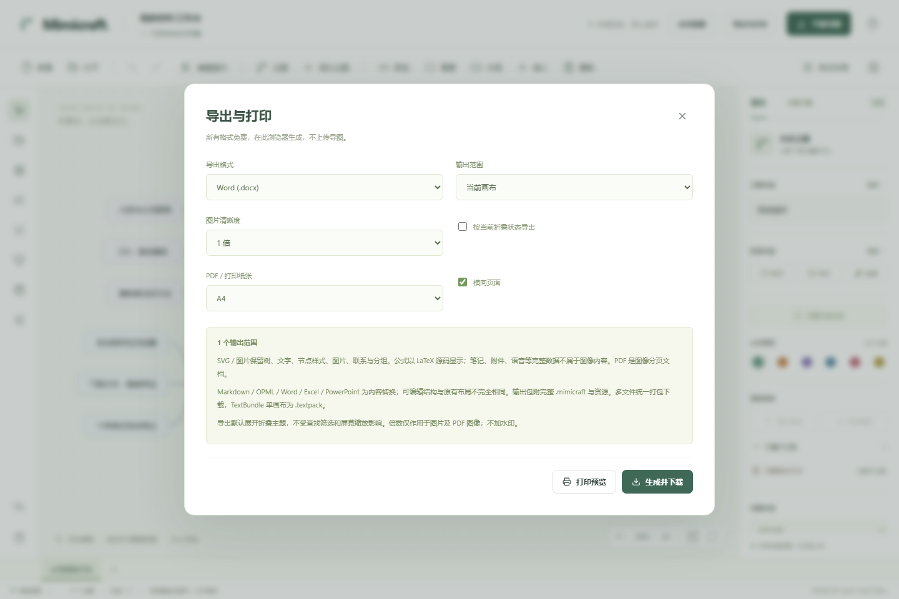

<div align="center">

# Mimicraft Mindmap

### 把灵感画成结构，把结构变成行动。

**免费开源 · 本地优先 · 十种布局 · 多画布 · 十种格式导出**

A free, local-first mind-mapping workspace for brainstorming, planning and presenting — built with React and TypeScript. Your documents are processed in your browser. The current interface is primarily in Chinese.

[](https://github.com/zhangtonghetony/mimicraft-mindmap/actions/workflows/pages.yml)
[](LICENSE)
[](app/package.json)

[**立即在线体验**](https://zhangtonghetony.github.io/mimicraft-mindmap/) · [下载源码 ZIP](https://github.com/zhangtonghetony/mimicraft-mindmap/archive/refs/heads/main.zip) · [功能清单](guide/FEATURES.md) · [反馈问题](https://github.com/zhangtonghetony/mimicraft-mindmap/issues)

</div>



## 一个属于自己设备的思考空间

Mimicraft Mindmap 将思维导图、内容笔记、任务计划和演说整理放在同一张画布中。你可以从模板开始，双击写下想法，用拖拽调整结构，再把结果带进报告、演示或下一步行动。

应用在浏览器中运行，文档自动保存在当前浏览器，也可以下载成独立文件，在另一台设备上重新打开。全部现有功能免费开放，应用没有账号系统、付费解锁、广告或文档上传后端。

适合个人知识整理、学习提纲、项目拆解、会议记录、写作构思与演示准备。目前是持续迭代的早期版本，欢迎带着真实场景一起打磨。

## 你可以用它做什么

| 能力 | 已实现内容 |
| --- | --- |
| **快速搭起结构** | 11 种原创模板；节点增删、多行编辑、Shift 多选、拖拽挂接与排序、层级调整、折叠、撤销/重做 |
| **为想法选择表达方式** | 思维导图、逻辑图、括号图、组织结构图、鱼骨图、时间轴、树形图、树型表格、矩阵图、网格结构 |
| **补足信息与关系** | 联系线与箭头、概要、外框、标注、笔记、标签、标记、网页/主题/本地路径链接、KaTeX 方程 |
| **加入内容与资源** | 局部富文本、贴纸、图标插画、本地图片、附件、音频与授权录音；资源可随原生文件自包含保存 |
| **让结构变成计划** | 待办、开始/截止日期、负责人、优先级、进度、任务面板和页面打开期间的到期提醒 |
| **找到自己的风格** | 节点字体/字号/颜色/宽度/形状/边框、分支线型、编号、六组配色、自定义配色、手绘效果、本地风格库 |
| **自由组织画布** | 自由主题、八种对齐/分布、自由分支位置、同级对齐、分支平衡、图层与多画布管理 |
| **专注与分享表达** | 大纲、查找、标签/标记筛选、分支聚焦、三种 ZEN 外观、四种演说外观、页面顺序/标题/备注/字号 |
| **减少重复操作** | 跨文档剪切/复制/粘贴、内部引用重映射、样式复制/粘贴/重置、键盘导航、常用快捷键、保存自定义模板 |
| **把成果带走** | 十种格式输出、主分支切图、1/2/3 倍图片、原始图片另存、独立分页打印、多画布输出 |
| **管理本地文件** | 自动保存、文件列表、改名、副本、回收与恢复、按画布或分支合并、密码加密下载/解密打开 |

功能状态、对应测试和边界见 [完整功能清单](guide/FEATURES.md)。云存储、在线分享/实时协作、其他产品原生格式兼容及 PWA 离线启动目前不在交付范围。

<details>
<summary><strong>看看样式编辑和演说模式</strong></summary>

### 主题样式与布局



### 把导图整理成演说



</details>

## 开始使用

### 方式一：直接打开网页

访问 **[Mimicraft Mindmap 在线版](https://zhangtonghetony.github.io/mimicraft-mindmap/)**，即可开始编辑。使用者无需运行本地服务器，也不需要安装 Node.js。

第一次可以这样试：

1. 点击「新建」，选择模板；双击主题修改文字。
2. 点击「细分主题」添加子节点，点击「主题」添加根级分支；拖动节点整理层级。
3. 通过「插入」添加笔记、标签、任务、图片或方程；通过「样式布局」调整表达。
4. 编辑后等待「已保存在此浏览器」；重要文档再点击「下载导图」备份。
5. 点击「导出与打印」生成分享文件；「文件管理」与底部标签提供多画布和文件操作。

**自动保存属于当前浏览器和网站来源。** localhost、GitHub Pages 或之后绑定的独立域名不会自动共享文档；迁移时先下载 `.mimicraft`，再到新地址打开。

### 方式二：下载 ZIP 源码运行

开发环境：**Node.js 24.x、pnpm 11.25.0**。浏览器自动化验收使用 Chromium；其他浏览器和手机触控的完整兼容性尚未承诺。

1. 点击仓库的 **Code → Download ZIP**，或[直接下载源码](https://github.com/zhangtonghetony/mimicraft-mindmap/archive/refs/heads/main.zip)。
2. 解压后，在包含 `app/` 的 `mimicraft-mindmap-main` 目录打开终端。
3. 如果尚未安装 pnpm，先运行 `npm install -g pnpm@11.25.0`，再执行：

```bash
pnpm --dir app install --frozen-lockfile
pnpm --dir app dev
```

打开终端显示的 Local 地址，通常为 `http://127.0.0.1:5173/`。首次依赖安装需要联网；源码 ZIP 不是双击即用的安装程序。使用在线版则不需要这些开发步骤。

### 方式三：Git clone

```bash
git clone https://github.com/zhangtonghetony/mimicraft-mindmap.git
cd mimicraft-mindmap
pnpm --dir app install --frozen-lockfile
pnpm --dir app dev
```

### 常用操作

| 操作 | 方式 |
| --- | --- |
| 编辑 / 提交 / 换行 / 取消 | 双击或 F2 / Enter / Shift+Enter / Escape |
| 添加子主题 / 根级主题 | 画布聚焦时 Tab / Enter |
| 多选 / 全选可见主题 | Shift+点击 / Ctrl 或 ⌘ + A |
| 撤销 / 重做 | Ctrl 或 ⌘ + Z / Y 或 Shift+Z |
| 复制 / 剪切 / 粘贴分支 | Ctrl 或 ⌘ + C / X / V |
| 下载当前原生文件 | Ctrl 或 ⌘ + S |
| 创建自由主题 | 双击画布空白，或「编辑操作」菜单 |
| 平移 / 缩放 | 拖动画布空白 / Ctrl 或 ⌘ + 滚轮 |

输入框中保留原生文字操作；浏览器快捷键存在差异时使用显式菜单。完整键位见应用内帮助。

## 导出与打印



| 格式 | 输出方式与重要细节 |
| --- | --- |
| PNG / JPEG | 1/2/3 倍；当前/全部画布、选中分支或主分支切图；无商业水印 |
| SVG | 独立矢量图与内嵌图片；无需网站 CSS；关系/分组及长标注使用编号图例 |
| PDF | 每个输出范围一页；A4/Letter、横向/纵向；**图像 PDF**，非可编辑矢量或可检索文字 PDF |
| Markdown / OPML | 层级与内容转换，资源及原生副本打包保存 |
| TextBundle | 单画布导出 `.textpack`，包含 `info.json`、`text.md`、`assets/`；多画布为 ZIP 中的独立 bundle |
| Word / Excel / PowerPoint | 正规 `.docx` / `.xlsx` / `.pptx` 文件；PPT 按演说可见页输出，长内容自动续页 |
| 打印 | 独立分页预览，调用浏览器打印；编辑器工具栏不进入打印内容 |

多文件和结构化文档通过一次 ZIP 下载提供，包内包含原生文件；需要使用 Word/Excel/PPT 时，先解压并打开对应文件。结构化输出包还附当前范围的 `.mimicraft`，避免有损映射后无法找回完整数据。

导出采用独立排版，部分手绘、插画和叠加效果有简化；**公式在图形输出中显示 LaTeX 源文**。图像不能表达完整笔记、语音或附件内容，结构化格式也不等于原生格式的无损替代。输出限制会在界面说明；SVG 不把未显示笔记或其他画布偷偷写入原始元数据。

## 保存、隐私与密码

- **浏览器自动保存**：IndexedDB 保存文档与本地模板，localStorage 保存风格/配色库。清理站点数据、隐私模式或空间不足可能影响留存，请定期下载备份。
- **可搬移原生文件**：`.mimicraft` 是自有、版本化 JSON 格式，当前 schema v4，兼容读取 v1/v2/v3；图片、附件和音频可自包含。
- **本地处理**：应用没有文档上传接口或分析追踪 SDK。静态托管方仍会处理普通网页请求；本地保存并不等于设备已经受到全面安全保护。
- **密码保护下载文件**：PBKDF2-SHA256（250000 次）与 AES-256-GCM，随机盐和 IV；口令只在当前文件会话内存中存在，刷新/切换文件后不保留，忘记无法找回。
- **浏览器副本仍为明文**：设置下载密码不会加密 IndexedDB；解密打开也不会替你记住密码用于下一次下载。界面会明确说明。
- **分享前检查输出范围**：结构化导出包可能包含完整原生数据及资源，分享前确认其中没有私人信息。

完整说明见 [文件格式](guide/FORMAT.md)和[安全边界](SECURITY.md)。

## 技术与验证

```text
React + TypeScript + Vite
        ↓
语义树 / 自由主题森林 / 多画布文档
        ↓
纯函数命令 → 快照历史 → HTML 节点 + SVG 连线
        ↓
IndexedDB 自动保存 / 原生文件 / 浏览器本地导出
```

| 组成 | 技术 |
| --- | --- |
| UI 与类型 | React 19、TypeScript 7、Vite 8、Lucide 图标 |
| 文档与画布 | 稳定节点标识、严格校验、HTML/SVG、自主布局算法、快照撤销重做 |
| 保存与加密 | IndexedDB、localStorage、Web Crypto |
| 数学与输出 | KaTeX、fflate、pdf-lib、docx、ExcelJS、PptxGenJS；重量级输出库按需加载 |
| 自动化 | Vitest、Playwright Chromium、GitHub Actions |
| 部署 | 静态 HTML/CSS/JS；GitHub Pages，可自行托管 `dist/` |

发布前基线：**48 项单元测试、46 项浏览器回归通过**；十种格式在生产构建中实际生成，并用独立读取库验证 PDF、Word、Excel、PowerPoint、图片和 TextBundle。测试数量是当前基线，不表示所有浏览器、Office 客户端或极限规模都已验收。详见 [验证记录](guide/VALIDATION.md)。

```bash
pnpm --dir app test
pnpm --dir app build
pnpm --dir app exec playwright install chromium
pnpm --dir app test:e2e --workers=4
```

生产输出位于 `app/dist/`；`pnpm --dir app preview` 可本地预览。预览端口与开发端口不同，浏览器数据不会自动共享。

## 项目结构与规划

```text
mimicraft-mindmap/
├── README.md / LICENSE / plan.md
├── guide/                 # 产品能力、架构、格式、验收与本应用截图
├── .github/workflows/     # 检查、构建与 GitHub Pages 发布
└── app/
    ├── src/               # 文档模型、布局、编辑器、视图、保存与输出
    ├── tests/             # 浏览器交互与实际文件验证
    ├── public/            # 原创站点图标、许可证
    └── package.json / pnpm-lock.yaml
```

P1 核心编辑与保存、P2 内容与结构表达、P3 布局/样式/视图/效率、P4 输出/多画布/文件/加密，已完成当前版本约定范围。接下来优先真实文档反馈、跨浏览器/Office 显示、性能和无障碍，而不是提前搭建通用平台。

**当前边界**：无云存储/在线协作；无其他产品原生文件兼容；提醒依赖网页打开；不保证离线启动；手机触控、真实麦克风和最大规模性能仍需专项验证。

数据保护上限为每文件 100 个画布、每画布 5000 节点/128 层/1000 联系/1000 分组、明文文件合计 8 MB，每节点最多 10 个资源且每资源 2 MB；图片每边不超过 16384 像素且总计不超过 4000 万像素。它们是技术边界，**不是收费档位或流畅性保证**。

路线与版本记录见 [plan.md](plan.md)，实现结构见 [架构说明](guide/ARCHITECTURE.md)。

## 自行部署与参与

GitHub Pages 工作流会在 `main` 更新后执行检查并发布；其他人 Fork 后，需要在仓库 **Settings → Pages** 选择 **GitHub Actions**。工作流使用 Pages 提供的路径设置 `PAGES_BASE_PATH`，兼容项目子路径。也可以把 `app/dist/` 放到任意静态托管服务，详见[部署说明](guide/DEPLOYMENT.md)。

欢迎提交 [Issue](https://github.com/zhangtonghetony/mimicraft-mindmap/issues) 或 Pull Request。请提供可复现步骤和脱敏样例；贡献方式见 [CONTRIBUTING.md](CONTRIBUTING.md)。

## 许可证与独立性

项目自有代码、产品文档与原创演示截图采用 [MIT License](LICENSE)。第三方依赖保留各自许可证，见 [THIRD_PARTY_NOTICES.md](THIRD_PARTY_NOTICES.md)；构建产物另含 `THIRD_PARTY_LICENSES.md`。

Mimicraft Mindmap 使用独立产品名称、自有实现与原创演示内容，不隶属于或获得任何其他思维导图厂商的背书，不包含其内部代码或品牌素材。MIT 许可授予的是本项目自有内容的权利，不覆盖第三方商标或第三方独立素材。
