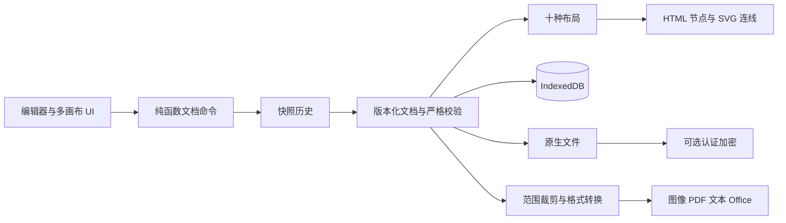

# Architecture

Mimicraft Mindmap 是独立的纯前端应用，React/TypeScript/Vite 构建为静态 HTML/CSS/JS。文档编辑、存储、文件校验、加密和输出均在浏览器执行。

## Source map

| 文件 | 责任 |
| --- | --- |
| app/src/model.ts | 文档类型、核心树命令、历史、严格文件校验、基本布局 |
| app/src/extended.ts / layouts.ts | 扩展类型/校验、配色/模板/编号、结构几何与连线 |
| app/src/operations.ts | 自由主题、位置/对齐/样式/图层、剪贴板与引用重映射 |
| app/src/workbook.ts | 多画布快照/顺序、文件副本及合并 |
| app/src/storage.ts / encrypted.ts | IndexedDB 事务/回收站，Web Crypto 文件保护 |
| app/src/App.tsx | 选择/编辑、坐标、拖放、键盘、保存状态与 UI 集成 |
| ContentEditor / RichTextField / Formula | 内容草稿、局部富文本、资源/录音与 KaTeX |
| Adornments / Views / Planning | 联系/分组、大纲/演说、任务/提醒与演说编排 |
| AdvancedPanel / TemplatesDialog / FileManager | 样式/模板/本地文件设置 |
| export-core / export-files / ExportDialog | 导出范围、独立 SVG/栅格、格式打包与打印 |

上表中未写完整前缀的文件也位于 app/src/，均为本应用代码，不是预建通用平台。

## Invariants

- 中心主题及自由主题形成森林；每个非根节点有且只有一个父级，所有节点可达，不允许环。
- 联系、分组与主题链接引用稳定标识，删除/复制/合并后必须清理或重映射。
- 当前画布与其他画布快照彼此独立，画布数据不能递归包含画布，顺序标识必须完整唯一。
- 文档内容/折叠/样式/手动位置可持久化；选择/输入草稿/平移缩放为临时 UI 状态。
- 命令创建新快照，取消和无变化不写历史；历史最多保留最近 100 次命令，不跨刷新恢复。
- 自动保存串行化、防抖并等待事务完成；加载失败暂停覆盖，写入失败保留内存内容与下载路径。
- 所有打开/合并先校验再应用；错误密码或坏文件不能替换当前文档。

## Performance boundaries

布局计算基于内容尺寸估计；自动布局对节点矩形避让，关系/分组是叠加表达，不承诺所有连线自动避让。自由位置允许用户主动重叠。

PDF/Word/Excel/PowerPoint/KaTeX 等按需加载。ExcelJS 是相对较大的独立块，仅在相应输出时加载。当前上限是数据保护边界，尚未做 5000 节点或 100 画布交互性能保证。
